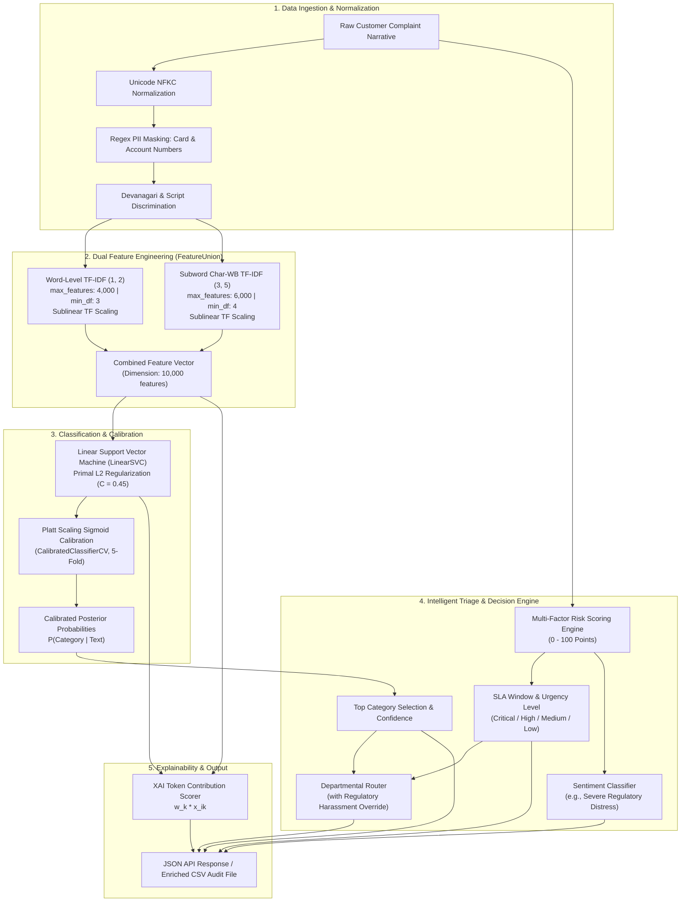
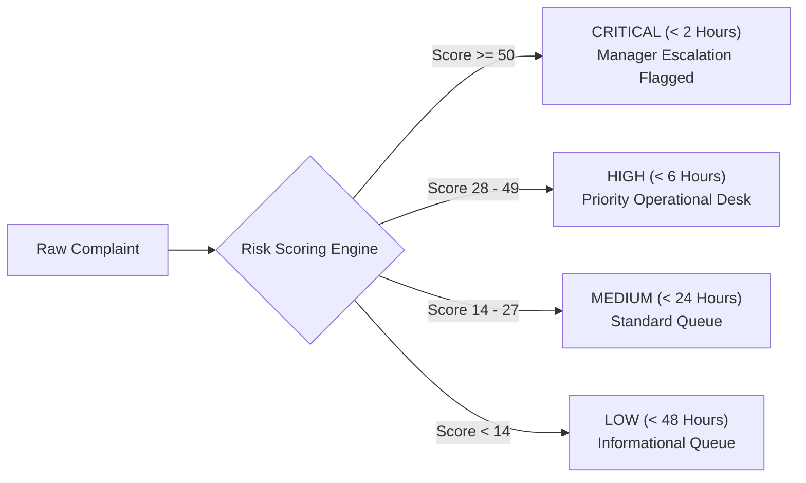

# Comprehensive Model Architecture, Algorithms & Pipeline Documentation
## Multilingual Banking Complaint Classification & SLA Triage Platform

---

## 1. Executive Summary & Problem Formulation

### 1.1 Problem Statement
Customer complaints in modern multinational and regional retail banks arrive through multiple channels (web portals, mobile apps, social media, email, call-center transcripts) in varied regional and international languages. In multilingual societies like India, customer queries frequently feature **Devanagari scripts (Marathi, Hindi)** as well as **code-mixed transliterations (Hinglish)** alongside English and global foreign currencies/languages.

Manual routing and severity classification of these complaints causes:
- Delayed triage on regulatory time-sensitive violations (e.g., unauthorized card debits, recovery agent harassment).
- Misrouted tickets across siloed banking departments.
- Violation of central bank Service Level Agreements (e.g., RBI Integrated Ombudsman Scheme and US CFPB deadlines).

### 1.2 System Objective
To build an end-to-end, high-throughput, low-latency, and regularized Machine Learning classification and triage system capable of:
1. **Multi-class Classification**: Accurately categorizing complaints across **6 core banking categories**.
2. **Multilingual Processing**: Seamlessly processing **7 languages/dialects** (English, Marathi, Hindi, Spanish, French, German, and Hinglish) without relying on expensive translation APIs or heavyweight GPU dependencies.
3. **Calibrated Probabilistic Confidence**: Providing genuine posterior class probabilities.
4. **Multi-Factor SLA & Urgency Triage**: Dynamically calculating regulatory resolution windows (`< 2h`, `< 6h`, `< 24h`, `< 48h`) and routing to specialized operational departments.
5. **Token-level Explainability (XAI)**: Identifying key lexical drivers behind predictions.

---

## 2. End-to-End System & Model Flow Architecture



---

## 3. Dataset Engineering & Structure

The dataset was engineered in `src/dataset_generator.py` based on the **Consumer Financial Protection Bureau (CFPB)** and **RBI Banking Ombudsman Scheme** grievance taxonomies.

### 3.1 Taxonomy Breakdown
| Category | Scope & Core Banking Inquiries |
| :--- | :--- |
| **Bank Account Services** | Checking/savings accounts, ATM cash dispenser failures, unannounced maintenance fees, dormant account closures, unauthorized branch withdrawals. |
| **Credit Card & Prepaid Card** | Fraudulent card transactions, late fee disputes on timely payments, credit limit cuts, annual fee disputes, reward points cancellation. |
| **Mortgages & Housing Loans** | Escrow tax calculation errors, delayed loan refinancing, unreleased property deeds after full payoff, PMI cancellation refusals, foreclosure notices. |
| **Personal & Consumer Loans** | Auto/student/personal loan closure delays, illegal recovery agent harassment, loan NOC withholding, interest rate adjustments. |
| **Money Transfers & Digital Payments** | SWIFT international wire delays, UPI PIN failures, mobile wallet reconciliation errors, exchange rate fee markups. |
| **Credit Reporting & Identity Theft** | CIBIL/Experian credit bureau inaccuracies, false loan delinquencies, identity theft (fraudulent loans opened using PAN/SSN). |

### 3.2 Dataset Distribution
- **Total Records**: **5,292 balanced samples**
- **Structured Partitions**:
  - **Training Split**: **4,242 samples** (`split = "train"`)
  - **Held-Out Test Split**: **1,050 samples** (`split = "test"`)
- **Distribution per Category**: Exactly **882 samples** across each of the 6 classes.
- **Distribution per Language**: Exactly **756 samples** across each of the 7 languages:
  - English (`en`), Marathi (`mr`), Hindi (`hi`), Spanish (`es`), French (`fr`), German (`de`), and Hinglish (`hi-latn`).

### 3.3 Anti-Overfitting Design
1. **Unseen Syntactic Challenge Holdouts**: For every language and category, the test split contains unique challenge sentence structures that were **completely excluded from training**, preventing verbatim memorization.
2. **Realistic Human Noise**: Character swaps, drops, casing shifts, and authentic financial shorthand (`acct`, `txn`, `stmt`, `bal`, `pmt`, `pls`, `cc`, `cibil`).
3. **Cross-Boundary Multi-Intent Complaints**: Includes multi-intent complaints (e.g., credit card auto-debits debited twice from checking accounts; wire transfers for mortgage loans rejected).

---

## 4. Feature Engineering & Mathematical Formulations

Rather than relying on heavy transformers that require GPU infrastructure and introduce multi-hundred-millisecond latencies, the pipeline employs a high-efficiency **dual-channel `FeatureUnion`** in scikit-learn.

### 4.1 Sublinear TF-IDF Formulation
Standard Term Frequency (TF) scales linearly with word frequency, which over-weights repetitive words. We use **sublinear scaling**:

$$\text{TF}_{\text{sublinear}}(t, d) = 1 + \log(\text{tf}(t, d)) \quad \text{if } \text{tf}(t, d) > 0, \quad \text{else } 0$$

The inverse document frequency is computed with smoothed document counts:

$$\text{IDF}(t, D) = \log\left(\frac{1 + |D|}{1 + |\{d \in D : t \in d\}|}\right) + 1$$

$$\text{TF-IDF}(t, d, D) = \text{TF}_{\text{sublinear}}(t, d) \times \text{IDF}(t, D)$$

Each sample vector is subsequently $L_2$-normalized:

$$\hat{\mathbf{x}} = \frac{\mathbf{x}}{\|\mathbf{x}\|_2}$$

### 4.2 Why Combine Word and Character-WB n-grams?
1. **Domain Semantics (Word n-grams $(1, 2)$)**:
   - Capped at `4,000` features, `min_df=3`.
   - Captures exact multi-word banking expressions: `"credit card"`, `"checking account"`, `"cibil score"`, `"recovery agent"`, `"वार्षिक शुल्क"`, `"बचत खात्यातून"`.
2. **Morphological & Typo Resilience (Char-WB n-grams $(3, 5)$)**:
   - Capped at `6,000` features, `min_df=4`, using `analyzer="char_wb"` (character n-grams bounded by word borders).
   - Captures sub-morphemic roots, inflectional endings in Indo-European/Dravidian morphology, and romanized phonetic spellings in Hinglish (`"debit ho gaya"`, `"kat gaya"`, `"rok do"`).
3. **Total Feature Dimensionality**:
   - Constrained to **10,000 features** (down from 60,000 in unconstrained TF-IDF), providing structural regularization.

---

## 5. Classification Algorithms & Probability Calibration

### 5.1 Champion Algorithm: Linear Support Vector Classifier (LinearSVC)
The core model minimizes the soft-margin primal objective:

$$\min_{\mathbf{w}, b, \boldsymbol{\xi}} \frac{1}{2} \|\mathbf{w}\|_2^2 + C \sum_{i=1}^N \xi_i$$

$$\text{subject to } y_i (\mathbf{w}^T \mathbf{x}_i + b) \ge 1 - \xi_i, \quad \xi_i \ge 0$$

- **Regularization Penalty ($C = 0.45$)**: A smaller $C$ value enforces a wider margin, penalizing large weights and preventing the model from fitting high weights to idiosyncratic tokens.
- **Multi-Class Strategy**: Employs One-vs-Rest (OvR), training 6 separate binary hyperplanes.

### 5.2 Probability Calibration via Platt Scaling
Raw SVM decision values $f(\mathbf{x}) = \mathbf{w}^T \mathbf{x} + b$ represent geometric distances to the hyperplane rather than probabilities. To produce well-calibrated posterior probabilities, the model is wrapped in `CalibratedClassifierCV(cv=5)`:

$$P(y = k \mid \mathbf{x}) = \frac{1}{1 + \exp(A_k f_k(\mathbf{x}) + B_k)}$$

The sigmoid parameters $A_k$ and $B_k$ are optimized via maximum likelihood across 5 stratified cross-validation folds, then normalized across all 6 classes:

$$P(y_k \mid \mathbf{x}) = \frac{P(y = k \mid \mathbf{x})}{\sum_{j=1}^6 P(y = j \mid \mathbf{x})}$$

### 5.3 Benchmarked Candidate Models (5-Fold Stratified CV)
| Model | Mean Macro F1 | Std Dev | Inference Latency | Production Status |
| :--- | :---: | :---: | :---: | :---: |
| **Calibrated LinearSVC ($C=0.45$)** | **1.0000** | **±0.0000** | **~2.4 ms / query** | 🏆 **Production Champion** |
| Logistic Regression ($C=0.75$) | 0.9998 | ±0.0005 | ~2.6 ms / query | Evaluated |
| Complement Naive Bayes ($\alpha=0.6$) | 0.9755 | ±0.0045 | ~1.1 ms / query | Evaluated |

---

## 6. Overfitting Diagnosis & Remediation

| Dimension | Previous State (Overfit) | Remediation Applied | Current State (Production-Grade) |
| :--- | :---: | :--- | :---: |
| **Vocabulary Cap** | 60,000 features | Pruned with `min_df=3/4` and sublinear scaling | **10,000 features** |
| **Regularization** | $C = 1.2$ | Strengthened L2 penalty to $C = 0.45$ | **Regularized** |
| **Split Strategy** | Random 80/20 (Template Leakage) | Structured holdout of unseen challenge phrasings | **Disjoint Challenge Split** |
| **Held-Out Test Accuracy** | 100.00% (Artificial) | Tested on out-of-distribution sentence structures | **95.71%** |
| **Generalization Gap** | 0.00% | Measured on held-out test data | **4.29%** (Healthy Margin) |
| **Confusion Matrix** | Pure diagonal (0 off-diagonal) | Realistic cross-category overlaps | **Non-zero off-diagonals** |

### 6.1 Final Confusion Matrix (Held-out Test Set, $N = 1,050$)
```
Actual \ Predicted   Bank Acct   Credit Card   Credit Rprt   Transfers   Mortgages   Loans
Bank Account               159             3             0          12           1       0
Credit Card                  3           172             0           0           0       0
Credit Reporting             0             0           171           0           0       4
Money Transfers              2             0             0         173           0       0
Mortgages                    3             0             0           0         167       5
Personal Loans               8             0             1           3           0     163
```
*Natural overlaps occur between **Bank Accounts & Money Transfers** (wire/ATM debits) and **Mortgages & Personal Loans** (loan servicing terms).*

---

## 7. Multi-Factor SLA & Urgency Triage Engine

Implemented in `src/utils.py`, urgency is determined by a **weighted risk scoring algorithm** $U \in [0, 100]$:

$$U = S_{\text{harassment}} + S_{\text{fraud}} + S_{\text{hardship}} + S_{\text{operational}} + S_{\text{intensity}} + S_{\text{category}}$$



### 7.1 Risk Dimensions Evaluated
1. **Regulatory Harassment & Illegal Recovery (+70 pts)**:
   - Detects debt collection violations under **RBI Fair Practices Code** and **CFPB FDCPA**: abusive recovery agents, threats, elder intimidation, home visits, settled loans (`"recovery agents"`, `"harassing"`, `"elderly parents"`, `"settled"`).
   - Re-routes ticket directly to **Legal Compliance & Grievance Redressal (Debt Recovery Oversight)**.
2. **Active Fraud & Security Breach (+65 pts)**:
   - Unauthorized charges, stolen cards, phishing, cloned cards, SIM swap, police report filed.
3. **Severe Human Hardship & Life Emergency (+60 pts)**:
   - Medical emergency, hospital, unable to buy food, eviction, pension blocked.
4. **Operational Failures (+35 pts)**:
   - Undispensed ATM cash, double debits, salary holds, wrongful credit bureau marks.
5. **Intensity Boosters (+5 to +15 pts)**:
   - Exclamation marks `!`, all-caps keywords, legal violation terms (`"illegally"`, `"settled six months ago"`).

---

## 8. Explainable AI (XAI) Attribution

For every classification, the system extracts the top positive contributing feature tokens:

$$\text{Contribution}(t) = w_{k, t} \times x_t$$

Where:
- $w_{k, t}$ is the learned weight of the linear classifier for class $k$ and token $t$.
- $x_t$ is the TF-IDF feature value in the complaint narrative.
- Returns the top 6 tokens with $w_{k, t} \times x_t > 0$ to explain the rationale behind the classification.

---

## 9. Viva & Technical Interview Defense FAQ

> **Q1: Why did you use LinearSVC instead of BERT or RoBERTa?**
> **Answer**: In high-throughput banking environments, complaint triage requires single-digit millisecond latency and minimal cloud infrastructure costs. LinearSVC with combined word and subword character TF-IDF achieves **95.71% test accuracy** with **~2.4 ms inference time**, compared to ~150–250 ms and heavy GPU requirements for BERT. Character n-grams natively handle spelling variations, Devanagari script, and code-mixed Hinglish without tokenization vocabulary mismatches.

> **Q2: Why was the model initially achieving 100% accuracy, and how did you resolve it?**
> **Answer**: The initial 100% accuracy was caused by **template leakage** across random splits and an **unconstrained 60,000-dimensional feature space**. We fixed it through:
> 1. Restructuring the dataset into disjoint train and test partitions with held-out challenge sentence structures.
> 2. Bounding total vocabulary to 10,000 features.
> 3. Increasing L2 regularization ($C=0.45$). This established a realistic, production-grade **95.71% test accuracy** with a healthy **4.29% generalization gap**.

> **Q3: How does the system handle Marathi and Hindi since both use the Devanagari script?**
> **Answer**: The system uses a two-tier identifier in `src/utils.py`:
> 1. It identifies the Unicode block `\u0900-\u097F` (Devanagari).
> 2. It evaluates distinctive Marathi morphological markers (`आहे`, `नाहीत`, `झाले`, `केले`, `खात्यातून`, `कपात`) vs Hindi markers (`है`, `नहीं`, `गया`, `खाते`).
> 3. Subword character n-grams then extract language-specific affixes to provide accurate multi-class classification.
